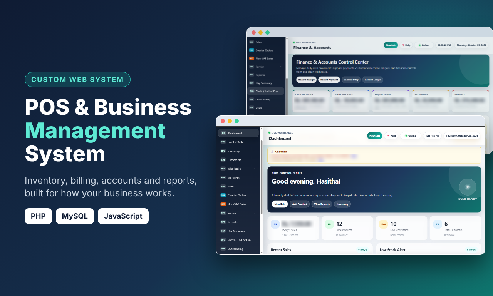
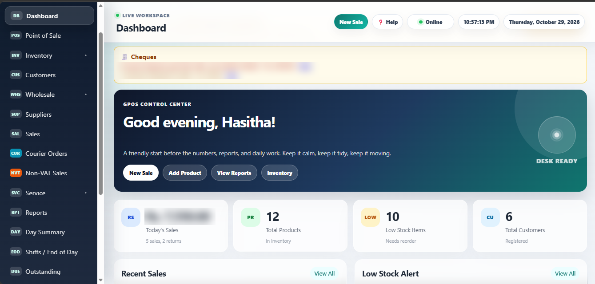
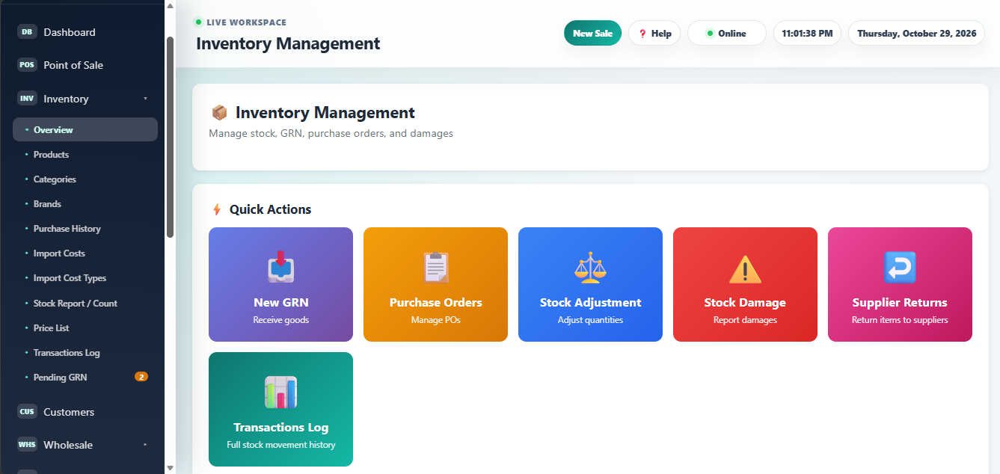
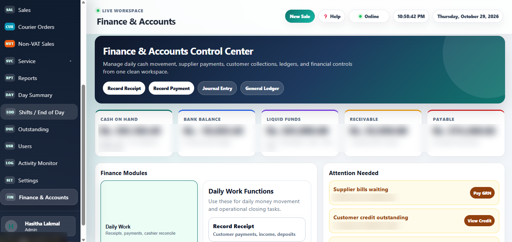
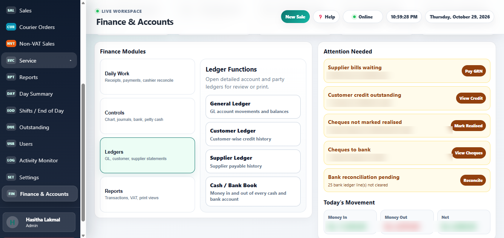
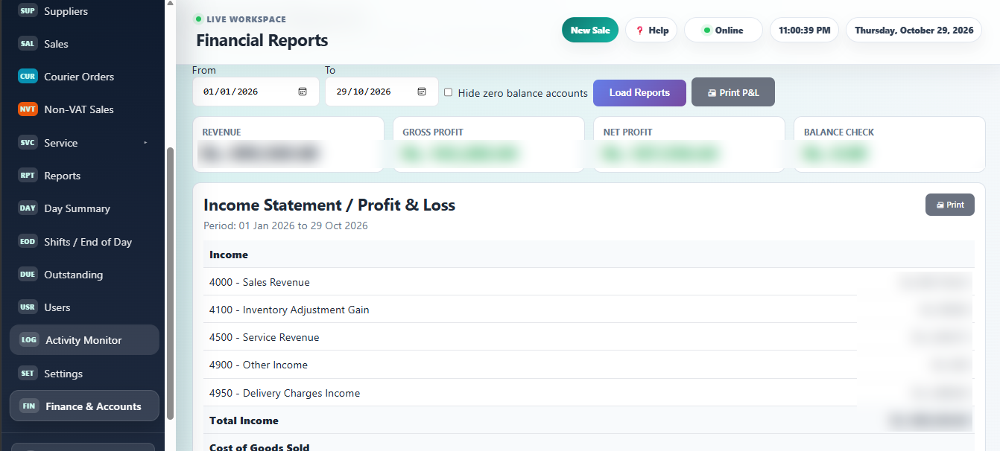

# G POS: Point of Sale & Business Management System

**G POS** is a web-based point of sale and business management system I built for Sri Lankan retail businesses. It handles daily sales, stock, suppliers, customers and the full accounting side of the business in one place.

> The source code is private because the system is used by real clients. A live demo is available on request.

## ✨ Features

**Point of Sale**
- Fast billing with barcode support and thermal receipt printing (English and Sinhala)
- Sinhala short-name product search
- Returns, credit sales and non-VAT sales
- Courier order management with delivery charge tracking
- Shifts, end-of-day cash reconciliation and day summary

**Inventory**
- Products, categories, brands and price lists
- GRN (direct, free and PO-based), purchase orders and pending GRNs
- Stock adjustments, damages and supplier returns
- Import cost tracking, stock count reports and full transaction log
- FIFO / weighted average stock valuation

**Finance & Accounts**
- Chart of accounts, journal entries and general ledger
- Customer and supplier ledgers, receivables and payables
- Profit & Loss statement and financial reports
- Cheque management (issued and received), bank reconciliation, petty cash
- Cash and bank book, daily receipts and payments
- VAT input and output reports, with separate handling for non-VAT sales

**Administration**
- User management with roles
- Activity monitor and audit logging
- Dashboard with sales, low-stock and cheque alerts

## 🛠️ Tech stack

Plain PHP (no framework), MySQL with prepared statements, and vanilla JavaScript.

## 📸 Screenshots

*Amounts are blurred to protect client data.*

**Dashboard**

**Inventory management**

**Finance & Accounts control center**

**Finance modules and alerts**

**Financial reports (P&L)**

## 📫 Contact

Built by **Hasitha Lakmal Jayasundara** (SWAG Solutions).  
Want a demo or a similar system for your business?

